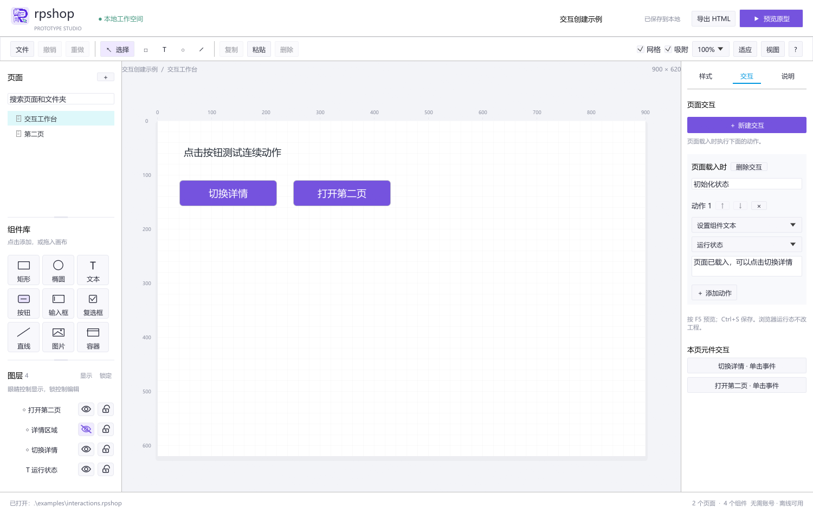
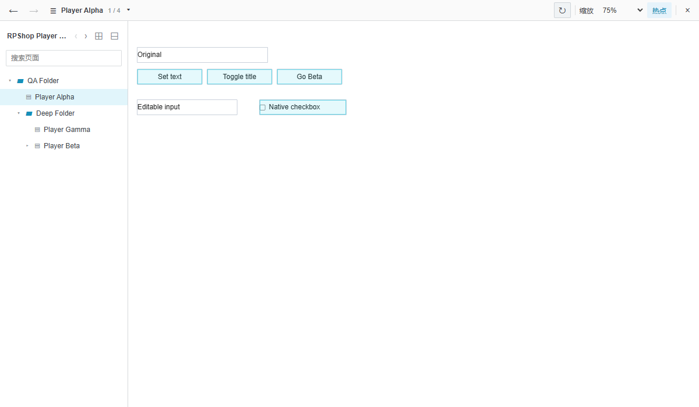
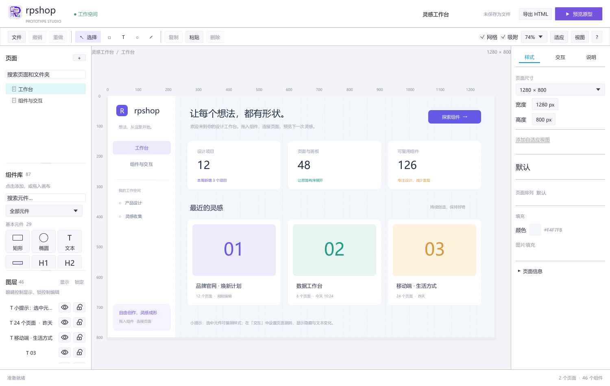

<p align="center">
  
</p>

# RPShop

## 目录

- [项目简介](#项目简介)
- [主要功能](#主要功能)
- [快速开始](#快速开始)
- [Windows 安装与文件打开](#windows-安装与文件打开)
- [开发与打包](#开发与打包)
- [本地数据与限制](#本地数据与限制)
- [项目结构与文档](#项目结构与文档)
- [许可证](#许可证)

## 项目简介

RPShop 是用 Rust 和 `eframe/egui` 编写的本地桌面原型工具，支持页面与元件编辑、交互制作、浏览器预览，以及 HTML/SVG 导出。新建工程使用独立的 `.rpshop` 格式。

原生文件支持范围为已验证样本覆盖的 **RP 8 ZIP 格式 `.rp`** 和 **RP 11 `.rp` / `.rplib`**。支持的编辑可直接保存回原格式；原生兼容属于部分实现，具体版本和写回限制见[本地数据与限制](#本地数据与限制)。功能规划见[路线图](docs/roadmap.md)。

## 主要功能

| 功能 | 说明 |
| --- | --- |
| 页面与导航 | 自有工程支持页面增删、重命名、尺寸和背景设置；原生文档保留文件夹与子页层级，支持搜索、展开和页面重命名。页面、组件库、图层三个区域独立滚动，可拖动分隔条调整高度并保存本机布局。 |
| 组件库与表单 | 提供基本元件、表单与菜单、标注、流程图、常用图标五组，可搜索、点击或拖入画布。输入框、文本域、复选框、单选按钮、下拉列表和列表框可在预览中操作，单选按钮支持互斥组。详见[组件库对照](docs/widget-library-parity.md)。 |
| 画布与编辑 | 支持多选、框选、拖动、八向缩放、旋转、网格与吸附，以及剪切、复制、粘贴、创建副本、撤销和重做。支持嵌套编组、图层显隐与锁定、六向对齐、两向分布和层级调整；图片翻转会修改像素，有可用路径的形状可翻转控制点。 |
| 属性与交互 | 右侧提供“样式 / 交互 / 说明”面板。可新建页面载入、元件单击事件，编辑和排序页面跳转、显隐、设置文本等动作；这些编辑参与撤销、恢复和 HTML 导出。 |
| 预览与导出 | 按 `F5` 在默认浏览器预览当前页，支持页面树、搜索、前进后退、页面深链接、缩放、适应窗口和热点显示。原生预览可运行支持的连续动作、动态面板状态与本工程内框架跳转。整个工程可导出单文件交互 HTML，当前页可导出静态 SVG，图片随工程和导出文件嵌入。 |
| 本地工作流 | 支持工程打开、保存、会话恢复与定时恢复备份。Windows 提供统一标题栏、开始菜单固定入口、文件打开方式和单实例文件转发。 |

<details>
<summary>界面预览</summary>







</details>

## 快速开始

### 使用发布包

已有 Windows 便携包时，解压后运行版本目录中的 `rpshop.exe`，无需安装 Rust。

### 从源码启动

从源码启动需要 Rust 1.89 或更新版本；Windows 还需要 MSVC C++ 构建工具和 Windows SDK。在项目根目录运行：

```powershell
powershell -ExecutionPolicy Bypass -File .\scripts\dev.ps1 run
```

开发环境已配置好时，也可直接运行或指定工程文件：

```powershell
cargo run --locked
cargo run --locked -- .\examples\welcome.rpshop
cargo run --locked -- --open .\my-project.rp
```

### 基本操作

首次启动显示可编辑的欢迎示例；正常启动会恢复本机会话。按 `Ctrl+O`、使用文件菜单或拖入文件可打开工程。

制作一个简单原型：

1. 新建工程并添加页面，在右侧“样式 → 页面信息”设置页名、尺寸和背景。
2. 从组件库添加元件，拖动调整位置和尺寸，在属性面板编辑文字与外观。
3. 进入“交互”，为页面或选中元件新建事件，添加并排序动作。
4. 按 `F5` 预览，返回编辑器修改后刷新浏览器查看最新内容。
5. 按 `Ctrl+S` 保存为 `.rpshop`；已有原生文件按支持范围保存回 `.rp` / `.rplib`，也可导出 HTML 或 SVG。

| 示例 | 用途 |
| --- | --- |
| [欢迎示例](examples/welcome.rpshop) | 页面、基础元件与交互入门 |
| [组件操作示例](examples/operations.rpshop) | 旋转、直线和组合 |
| [交互创建示例](examples/interactions.rpshop) | 页面载入、连续显隐、设置文本与页面跳转 |
| [组件画廊](examples/library.rpshop) / [浏览器画廊](examples/library.html) | 分类浏览组件与预设 |

<details>
<summary>快捷键与画布操作</summary>

文本输入获得焦点时优先编辑文字，画布快捷键让位于输入框。图层右侧的眼睛控制显示与隐藏，锁图标控制编辑锁定；点击图标不切换当前选择。

| 快捷键或操作 | 功能 |
| --- | --- |
| `Ctrl+N` / `Ctrl+O` / `Ctrl+S` | 新建 / 打开 / 保存 |
| `Ctrl+Shift+S` | 另存为 |
| `Ctrl+Z` / `Ctrl+Y` 或 `Ctrl+Shift+Z` | 撤销 / 重做 |
| `Ctrl+X` / `Ctrl+C` / `Ctrl+V` / `Ctrl+D` | 剪切 / 复制 / 粘贴 / 创建副本 |
| `Ctrl+A` | 选择当前页面可见且未锁定的组件 |
| `Ctrl` 或 `Shift` + 点击 | 增减多选组件 |
| `Ctrl+Alt` + 点击 | 选择组内元件 |
| `Ctrl+G` / `Ctrl+Shift+G` | 组合 / 解开一层组合 |
| `R` / `O` / `T` / `L` / `V` | 矩形 / 椭圆 / 文字 / 直线 / 选择工具 |
| `Ctrl+Shift+B` / `Ctrl+Shift+E` / `Ctrl+Shift+T` | 矩形 / 椭圆 / 文字工具 |
| `Ctrl+Alt+L/C/R/T/M/B` | 左 / 水平居中 / 右 / 上 / 垂直居中 / 下对齐 |
| `Ctrl+Shift+H` / `Ctrl+Shift+U` | 水平 / 垂直分布 |
| `Ctrl+Shift+K` | 全部锁定；全选对象已锁定时全部解锁 |
| 空白画布拖动 | 框选组件，识别旋转后的元件范围 |
| `Shift` + 拖动移动 | 沿主要移动轴约束 |
| `Shift` + 缩放手柄 | 保持宽高比例 |
| `Alt` + 缩放手柄 | 围绕中心缩放；可同时按 `Shift` |
| `Shift` + 旋转手柄 | 按 15° 吸附 |
| 方向键 / `Shift` + 方向键 | 移动 1 / 10 像素 |
| `Ctrl` + 方向键 / `Ctrl+Shift` + 方向键 | 固定左上角调整尺寸 1 / 10 像素 |
| `Delete` / `Backspace` | 删除选中的未锁定组件 |
| 滚轮 / `Shift` + 滚轮 | 垂直 / 水平滚动画布 |
| `Ctrl` + 滚轮 | 以鼠标位置为锚点缩放，范围为 10%–1000% |
| `Space` + 拖动 / 中键拖动 | 临时平移画布 |
| `Ctrl+加号` / `Ctrl+减号` / `Ctrl+0` | 放大 / 缩小 / 100% |
| `Ctrl+1` / `Ctrl+2` / `Ctrl+3` / `Ctrl+9` | 居中画布 / 适配选择 / 居中选择 / 移至原点 |
| `F5` | 在默认浏览器预览当前页 |
| `Esc` | 结束文本弹窗、取消绘图或拖动 |

Enter 进入元件编辑、Tab/Shift+Tab 元件遍历、全部工具和容器修饰键尚未覆盖；高精度触控板、缩放动画和可配置移动量仍需核对。系统剪贴板使用 RPShop 自有元件数据格式，不声明与其他编辑器的元件剪贴板互通。

</details>

## Windows 安装与文件打开

### 首次安装

在仓库中打包并安装到当前用户，需要 Python 3.9+ 和已配置的 Rust/MSVC 环境，无需管理员权限：

```powershell
powershell -ExecutionPolicy Bypass -File .\scripts\package.ps1 -Install -OutputDirectory .\dist\installed-candidate
```

安装后从“开始菜单 → Shop → RPShop”启动。快捷方式始终指向稳定启动器 `%LOCALAPPDATA%\Programs\Shop\RPShop\RPShop.exe`，由它读取最新完整版本的位置。

已有完整解压包也可安装：

```powershell
powershell -ExecutionPolicy Bypass -File .\scripts\install.ps1 -PackageDirectory 'D:\Packages\RPShop-1.0.0-windows-x64'
```

### 后续更新

同一仓库已有安装时，后续普通的成功打包会自动更新安装：

```powershell
powershell -ExecutionPolicy Bypass -File .\scripts\package.ps1 -OutputDirectory .\dist\next-candidate
```

同一版本再次打包请指定新的输出目录，已有同名发布包不会覆盖；加 `-NoInstall` 可跳过安装刷新。已有窗口保留当前会话，关闭旧窗口后，再从固定入口打开即可使用新版。持续集成、跨平台构建及其他仓库检出不自动更新本机安装。

### 文件关联

安装会把 `.rpshop`、`.rp`、`.rplib` 和 `.json` 注册为“打开方式”候选，保留现有默认程序。`.json` 内容须为 RPShop 工程，原生文件仍受兼容范围限制。需要默认打开时，请在 Windows“默认应用”或文件的“打开方式”中选择 RPShop；安装脚本不静默更改默认应用。

Windows 下同一用户登录会话中的重复启动会恢复、聚焦已有窗口，并将文件交给该窗口。当前工程有未保存内容时，继续沿用保存、放弃或取消确认；取消会保留当前工程。命令行导入、示例导出和本地预览服务独立运行，截图模式也与正常图形界面会话隔离。

安装、自动更新范围、快捷方式与默认应用的详细说明见 [Windows 用户安装与文件打开方式](docs/windows-installation.md)。

## 开发与打包

### 开发检查

统一运行格式检查、静态检查和默认测试：

```powershell
powershell -ExecutionPolicy Bypass -File .\scripts\dev.ps1 verify
python -m unittest discover -s scripts/tests -v
python scripts/check-structure.py
```

也可在已配置的开发环境中分别运行 `cargo fmt --all --check`、`cargo clippy --locked --all-targets -- -D warnings` 和 `cargo test --locked`。需要实文件或专用环境的测试按各自条件显式运行，验证记录见[验证记录](docs/validation.md)。

### 发布打包

仅生成便携包并跳过本机安装刷新：

```powershell
powershell -ExecutionPolicy Bypass -File .\scripts\package.ps1 -NoInstall -OutputDirectory .\dist\candidate
```

Windows 输出带版本号的目录、ZIP 和 `.sha256` 校验文件，包内包含程序、使用说明、版本信息、安装入口与第三方许可。发布程序使用静态 MSVC CRT，图标嵌入 EXE。`dev.ps1 release` 只编译。

macOS/Linux 可运行 `python3 scripts/package.py` 生成 tar.gz。各平台所需工具链与动态库见[架构与打包说明](docs/architecture.md)。

生成示例工程、交互 HTML 和第一页 SVG：

```powershell
cargo run --locked -- --export-demo .\examples
```

此命令会覆盖 `examples/welcome.rpshop`、`examples/welcome.html` 和 `examples/welcome.svg`。重新生成组件画廊可运行 `cargo run --locked --example library-showcase -- examples`。

生成界面截图：

```powershell
cargo run --locked -- --screenshot .\docs\screenshots\editor.png
```

截图模式默认使用欢迎示例，写入图片后退出，正常会话保持独立。

### 持续集成

本地和持续集成共用打包脚本；只有推送与 Cargo 版本一致的 `v<version>` 版本标签才创建 GitHub 发布版本。Windows 包未签名，macOS 包未签名、未公证；跨平台构建和启动状态以实际持续集成与目标机器验证为准。

## 本地数据与限制

### 本地数据

工程文件由用户选择保存位置；会话恢复、定时恢复备份和界面布局保存在本机。

预览使用本机内存中的工程快照；编辑、撤销或保存后刷新浏览器可读取最新内容。浏览器中的输入、显隐和文本变化属于运行态，刷新会重置，也不会回写工程。导出的 HTML 保留导出时的快照。更多操作说明见[元件操作对照](docs/component-operations.md)和[交互对照](docs/interaction-parity.md)。

### 支持范围

| 文件类型 | 支持范围 |
| --- | --- |
| `.rpshop` / RPShop `.json` | 打开、编辑与保存本工具工程 |
| RP 8 ZIP 格式 `.rp` | 直接打开，编辑支持的内容并保存回同一 ZIP 原生格式；已有真实样本检查 |
| RP 11 `.rp` | 直接打开并保存支持的编辑；部分兼容 |
| RP 11 `.rplib` | 直接打开并保存支持的编辑；部分兼容 |
| RP 8 `.rplib` | 尚无单独的验证样本 |
| RP 9 / RP 10 及其他版本 | 未验证，不声明支持；按文件内部格式和版本识别 |
| `.rpteam` / `.rpteamlib` | 暂不支持团队工程与团队组件库 |

### 使用限制

#### 原生打开与保存

原生文件可直接打开后按 `Ctrl+S` 保存，无需转换为 `.rpshop`。打开后请查看界面的还原与编辑限制，并核对画面和交互。

- 支持范围包括页面重命名、基础元件的文字、位置、尺寸、旋转、样式、显隐与锁定，以及已支持的组件增删、嵌套组、图像/路径翻转和页面跳转；具体取决于版本与元件类型。
- RP 8 保留 ZIP 容器及嵌套分页对象包，RP 11 更新修改的部件和索引；未编辑部件保留原始字节，不升级或转换文件格式。写入采用同目录临时文件与原子替换，源文件被其他程序修改时拒绝覆盖。
- 原生保存成功后重新读取文件建立检查点，并重置当前撤销历史。原生页面或文件夹增删、目录结构调整、画板尺寸修改、跨页移动现有组件、复杂容器结构重排和组件库结构修改尚不支持，保存前会拒绝相关操作。
- 新增单选按钮、文本域、下拉列表和列表框写回原生文件时，当前文件须已有同类对象作为模板；缺少模板时拒绝保存。自有 `.rpshop` 工程没有这项模板限制。基础容器尚不支持原生写回，组合预设也不会转换为原厂专用表格、菜单或树对象。
- 原生文件读取上限为 256 MiB，单个部件解压上限为 64 MiB；自有工程另受模型大小与组件数量限制。完整原厂编辑器互操作尚未验证，未显示的原始数据不代表可以完整编辑。

需要另行生成 RPShop 工程时，可使用可选转换命令：

```powershell
cargo run --locked -- --import .\my-project.rp .\my-project.rpshop
```

输出必须使用 `.rpshop` 扩展名；命令会报告页面、组件与兼容限制。调查依据见[原生文件调查](docs/rea-findings.md)和[兼容调查](docs/native-compat-fix.md)。

#### 编辑、预览与导出边界

- 原生自动（Auto）、固定宽高与单轴固定尺寸会保留，但原生页面尺寸只读；原生自动尺寸页面默认按 100% 从标尺原点打开。自有工程可编辑这四种尺寸模式。
- 编辑画布只展示原生动态面板的首状态，原生浏览器预览保留全部状态并运行支持的动作；中继器仅显示一份模板，自适应页面采用默认视图。新建动态面板、状态编辑、中继器数据行为和自适应断点尚未提供。内联框架可显示本工程页面，外部网页框架与关联快照编辑尚未提供。
- 条件、变量与非字面表达式、拖拽驱动移动、推拉布局、面板自动循环和数据筛选尚未实现；不支持的动作会提示并停止对应的交互用例。页面说明与调试控制台尚未实现，动画和复杂框架行为仍有差异。
- 表格、菜单和树为可解组的组件组合，基础容器和流程图形不具备完整专用控件行为；流程图连接器不会自动吸附或跟随对象。形状翻转要求已有可用路径，不自动将其他形状转换为矢量路径。
- HTML 预览中的表单用于原型演示，不提交业务数据；SVG 中的表单为静态外观。SVG 按宽度自动换行、高级文字排版、独立文字旋转及母版缩放后重开的自然尺寸语义仍不完整或未验证。组件库预览为静态展示。

这些边界及测试覆盖详见[组件库对照](docs/widget-library-parity.md)、[元件操作对照](docs/component-operations.md)和[交互对照](docs/interaction-parity.md)。

## 项目结构与文档

| 路径 | 职责 |
| --- | --- |
| `src/main.rs`、`src/app.rs`、`src/cli.rs` | 桌面启动与命令行入口 |
| `src/model.rs`、`src/model/` | 工程模型、校验与内置示例 |
| `src/ui/` | 编辑器分区、元件绘制、文件打开与界面测试 |
| `src/rp_format/` | RP 原生容器、对象图、兼容读取与写回 |
| `src/shell_open.rs` | 文件参数解析、Windows 单实例与请求转发 |
| `src/preview.rs` | 本机内存预览服务 |
| `src/export.rs`、`src/player.*`、`src/prototype.js` | HTML/SVG 导出、播放器及原型运行时 |
| `scripts/`、`docs/` | 开发与安装工具、验证记录、调查和路线图 |

文档导航：

- [架构与打包说明](docs/architecture.md)：开发约定、平台依赖与打包方式。
- [Windows 用户安装与文件打开方式](docs/windows-installation.md)：安装、更新、快捷方式与默认应用。
- [结构调整记录](docs/refactoring.md)：模块职责与拆分说明。
- [组件库对照](docs/widget-library-parity.md)、[元件操作对照](docs/component-operations.md)、[交互对照](docs/interaction-parity.md)：功能范围与操作边界。
- [原生文件调查](docs/rea-findings.md)、[兼容调查](docs/native-compat-fix.md)：RP 格式读取与写回依据。
- [验证记录](docs/validation.md)、[路线图](docs/roadmap.md)：测试结果与后续规划。
- [品牌资产说明](assets/branding/README.md)：首页标志与程序图标。

工程与播放器独立编写，运行不依赖原厂编辑器安装目录。

## 许可证

代码采用 [MIT 许可证](LICENSE)。
